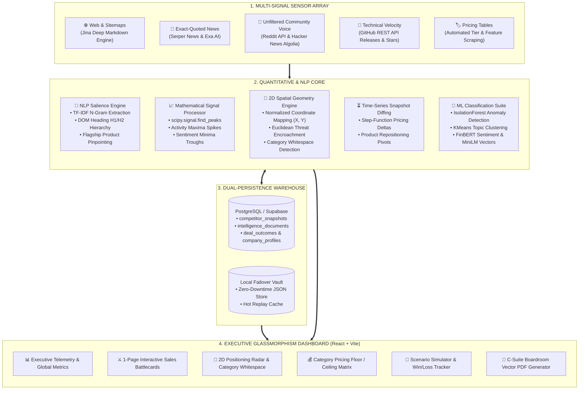
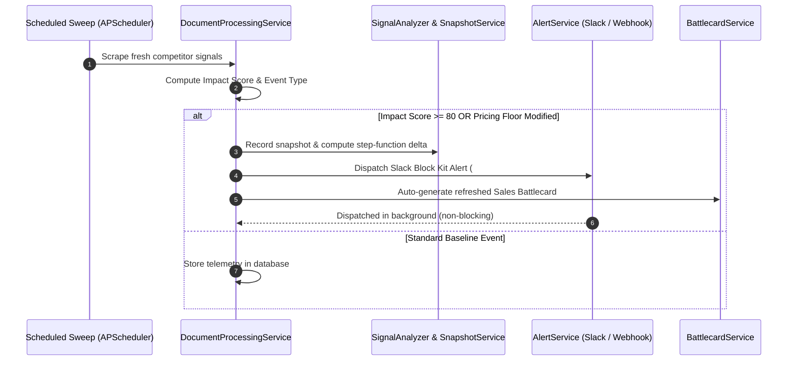

<div align="center">

# 🌌 Atheris
### Autonomous Competitive Intelligence & GTM Strategy Engine
**Multi-Signal Ingestion • Deterministic Signal Mathematics • 2D Spatial Positioning Radar • Autonomous Sales Battlecards**

[](https://fastapi.tiangolo.com)
[](https://python.org)
[](https://reactjs.org/)
[](https://vitejs.dev/)
[](https://tailwindcss.com/)
[](https://groq.com)
[](https://scipy.org)
[](https://supabase.com)
[](LICENSE)

<p align="center">
  <b>A real-time, quantitative competitive intelligence platform designed to outperform legacy $50k/year software (Klue, Crayon, Kompyte).</b><br>
  Continuous sensor grid monitoring across 15+ channels, mathematical inflection point detection (SciPy <code>find_peaks</code>), TF-IDF flagship product extraction, 2D Euclidean threat encroachment mapping, autonomous sales battlecards, and boardroom-ready vector PDF briefs.
</p>

[Live Backend API](https://ai-backend-zfq1.onrender.com) • [Interactive Swagger Docs](https://ai-backend-zfq1.onrender.com/docs) • [Frontend Guide](frontend/README.md) • [Backend Guide](Backend/README.md)

</div>

---

## 📑 Table of Contents

- [Overview](#-overview)
- [Why Atheris](#-why-atheris)
- [Master System Architecture](#-master-system-architecture)
- [Key Features & Intelligence Weapons](#-key-features--intelligence-weapons)
- [Mathematical & Signal Processing Core](#-mathematical--signal-processing-core)
- [Monorepo Directory Structure](#-monorepo-directory-structure)
- [API Reference (The 16 Intelligence Endpoints)](#-api-reference-the-16-intelligence-endpoints)
- [Getting Started](#-getting-started)
  - [Prerequisites](#prerequisites)
  - [Backend Setup](#1-backend-setup)
  - [Frontend Setup](#2-frontend-setup)
- [Environment Variables](#-environment-variables)
- [Autonomous Alerting & GTM Dispatch Loop](#-autonomous-alerting--gtm-dispatch-loop)
- [Production Deployment](#-production-deployment)
- [License](#-license)

---

## 💡 Overview

**Atheris** is an end-to-end, full-stack enterprise competitive intelligence platform. Traditional market research tools rely on infrequent manual reports or basic web scraping that over-alerts on trivial blog posts while missing critical competitive moves. 

Atheris bridges deterministic mathematical signal processing with state-of-the-art large language models (`llama-3.3-70b-versatile` via Groq) to deliver real-time, high-confidence intelligence to product leaders, GTM strategists, and enterprise sales teams.

---

## ⚡ Why Atheris?

| Challenge with Legacy Scrapers | How Atheris Solves It |
| :--- | :--- |
| **Zero Time Memory:** Overwrites state on every scrape without tracking historical evolutions. | **Immutable Time-Series Snapshots:** Records discrete step-function deltas ($\Delta P_{\min}$, product pivots, feature launches) over 30/60/90 days. |
| **Hallucination of Anchor Offerings:** LLMs mistake footer links and minor blog tags for actual revenue drivers. | **NLP Salience & Header Centrality:** Uses TF-IDF N-Gram scoring weighted by DOM header hierarchy ($H_1$, $H_2$) to identify the true Flagship Product. |
| **Cognitive Fatigue & Noise Overload:** Floods teams with alerts for every minor sentence change. | **Mathematical Extrema Detection:** SciPy `find_peaks` isolates moves that exceed $\mu + 0.8\sigma$ baseline threshold, ignoring noise. |
| **Static Text-Only Outputs:** Static bullet points that don't help sales reps close deals. | **Autonomous GTM Weapons:** Generates real-time 1-page sales battlecards, 2D threat encroachment radars, pricing whitespaces, and scenario simulations. |

---

## 🏛️ Master System Architecture



---

## 🎯 Key Features & Intelligence Weapons

### 1. 📊 Executive Overview & Intelligence Telemetry
- Real-time global dashboard displaying total competitors monitored, critical intelligence events, high-priority threats, active sales tasks, and unacknowledged alerts.
- Live background monitoring sweep status (`CHECK NOW`) with step-by-step progress tracking.

### 2. ⚔️ Autonomous Sales Battlecards & Battle Simulator
- **1-Page Battle Weapon:** Instant competitive dismissal playbooks, 3 landmines to lay in sales calls, competitor strengths/weaknesses, and objection handling counters.
- **Scenario Simulator:** Real-time conversational simulator to pressure-test pitches against aggressive competitor tactics.

### 3. 🎯 2D Spatial Positioning Radar
- Maps your organization and all competitors on a continuous $[0, 100] \times [0, 100]$ geometric plane:
  - **X-Axis:** Market Target & Price Tier (Freemium/SMB $\rightarrow$ Enterprise).
  - **Y-Axis:** Product Architecture Scope (Point Tool $\rightarrow$ All-in-One Platform).
- **Euclidean Threat Encroachment:** Mathematical calculation of distance vector $d(\text{us}, c) = \sqrt{(x_{\text{us}} - x_c)^2 + (y_{\text{us}} - y_c)^2}$. Alerts when $d < 20.0$.
- **Autonomous Whitespace Discovery:** Automatically pinpoints uncontested coordinate niches $(\hat{x}, \hat{y})$ that maximize clearance from all players.

### 4. 🏷️ Dynamic Pricing Matrix & Whitespace Analysis
- Parses complex pricing tables into structured numerical values.
- Computes Category Entry Floor ($P_{\min}$), Enterprise Ceiling ($P_{\max}$), and flags pricing voids ($\ge \$50/\text{mo}$ whitespace gaps).

### 5. ⏳ Time-Machine Slider & Snapshot Deltas
- Step-function differentiation of competitor actions over time.
- Identifies exact price floor hikes, tier restructuring, feature deprecation, and positioning shifts.

### 6. 🌐 Multi-Signal Market Feed & Community Voice
- Ingests from Google News, Serper, Exa, Hacker News, and Reddit.
- Automatically scores event impact (Critical, High, Medium, Low) and performs FinBERT financial sentiment classification.

### 7. 💼 Commercial Win/Loss Intelligence
- Track deal outcomes (`WON`, `LOST`, `TIED`) with competitor attribution.
- Real-time analytics on win rate percentage, lost deal pipeline value, and root cause distributions (Price vs. Features vs. Ease of Use).

### 8. 📑 Boardroom-Ready Vector PDF Generation
- One-click export of an executive multi-page strategic intelligence briefing powered by ReportLab.

---

## 🧮 Mathematical & Signal Processing Core

### Inflection Maxima & Minima Detection (`scipy.signal.find_peaks`)
Rather than drowning in news volume, Atheris treats competitor activities as a discrete time-series signal $S(t) = [s_1, s_2, \dots, s_n]$ and identifies mathematical extrema:
- **Local Maxima (Activity Peaks):**
  $$\text{Peaks} = \{ t \mid S(t) > S(t \pm 1) \quad \text{and} \quad \text{Prominence}(S(t)) \ge \max(1.0, 0.8 \cdot \sigma) \}$$
  Flags major product launches, capital raises, and aggressive PR blitzes before they hit traditional analyst reports.
- **Local Minima (Sentiment Troughs):**
  By inverting customer sentiment signals across Reddit and developer forums, Atheris detects churn waves and customer dissatisfaction opportunities.

### NLP Flagship Product Salience
Competitors list dozens of minor features. The NLP engine isolates the core revenue driver using DOM header hierarchy and TF-IDF salience:
$$\text{Salience}(p) = 3 \cdot \text{Freq}_{\text{DOM Headers } (H_1, H_2)} + \sum_{d \in \text{Body}} \text{TF-IDF}(p, d)$$

---

## 📁 Monorepo Directory Structure

```text
Atheris/
├── Backend/                                # High-performance Python / FastAPI Engine
│   ├── main.py                             # Main application server & API routes
│   ├── config.py                           # Pydantic environment configuration
│   ├── database.py                         # Supabase / PostgreSQL persistence & failover
│   ├── models.py                           # Pydantic v2 domain schemas & request contracts
│   ├── signal_analyzer.py                  # SciPy peak finding & inflection detection
│   ├── positioning_engine.py               # 2D Euclidean spatial geometry & whitespace
│   ├── battlecard_service.py               # Autonomous sales battlecard generator
│   ├── battle_simulator_service.py         # Real-time GTM battle simulator
│   ├── pricing_matrix_service.py           # Structured tier & pricing gap analysis
│   ├── snapshot_service.py                 # Time-series diffing & step-function deltas
│   ├── pdf_report_service.py               # Vector PDF boardroom brief builder (ReportLab)
│   ├── community_signals_service.py        # Reddit & Hacker News ingestion
│   ├── github_monitoring_service.py       # Code velocity, releases & GitHub stars
│   ├── ci_model_suite.py                   # ML Anomaly detection (IsolationForest) & KMeans
│   ├── action_dispatch_service.py          # Automated task & action generator
│   ├── alert_service.py                    # Slack Block Kit & generic webhook alerts
│   ├── requirements.txt                    # Python dependencies
│   └── README.md                           # Backend-specific architecture documentation
│
├── frontend/                               # Glassmorphism React 18 + Vite Web Application
│   ├── src/
│   │   ├── App.jsx                         # Main dashboard shell & context provider
│   │   ├── api.js                          # Typed API client with JWT & interceptors
│   │   ├── index.css                       # Modern Tailwind styling & dark mode definitions
│   │   ├── components/                     # Modular dashboard components
│   │   │   ├── OverviewSection.jsx         # Executive metrics & top threat alerts
│   │   │   ├── CompetitorsSection.jsx      # Competitor management & discovery
│   │   │   ├── BattlecardModal.jsx         # 1-Page sales weapon & landmines
│   │   │   ├── BattleSimulatorModal.jsx    # Real-time pitch testing simulator
│   │   │   ├── PositioningRadar.jsx        # Interactive 2D coordinate canvas
│   │   │   ├── PricingMatrixWidget.jsx     # Side-by-side pricing tier whitespace
│   │   │   ├── SideBySideSection.jsx       # Head-to-head feature matrix
│   │   │   ├── SwotAnalysisSection.jsx     # AI SWOT matrix generator
│   │   │   ├── MarketIntelligenceSection.jsx # Live multi-signal news feed
│   │   │   ├── TrendsSection.jsx           # Sentiment & Share of Voice analytics
│   │   │   ├── ActionCenterSection.jsx     # Strategic tasks & workflow dispatch
│   │   │   ├── AlertsSection.jsx           # Global alert center & notifications
│   │   │   ├── AIStrategySection.jsx       # Weekly AI strategic brief
│   │   │   ├── WinLossModal.jsx            # Commercial deal tracking modal
│   │   │   └── CompetitorDossierModal.jsx  # 360-degree competitor profile
│   ├── package.json                        # Node dependencies (React, Vite, Three.js, Lucide)
│   ├── tailwind.config.js                  # Tailwind design system configuration
│   └── README.md                           # Frontend-specific documentation
│
└── README.md                               # Project documentation (this file)
```

---

## 📡 API Reference (The 16 Intelligence Endpoints)

- 🌐 **Live Production Base URL:** [`https://ai-backend-zfq1.onrender.com`](https://ai-backend-zfq1.onrender.com)
- 📖 **Interactive Swagger UI:** [`https://ai-backend-zfq1.onrender.com/docs`](https://ai-backend-zfq1.onrender.com/docs)
- 📄 **OpenAPI Specification:** [`https://ai-backend-zfq1.onrender.com/openapi.json`](https://ai-backend-zfq1.onrender.com/openapi.json)

| # | Endpoint | Method | Service / Engine | Strategic Deliverable |
|---|---|:---:|---|---|
| **1** | `/api/competitors/{id}/battlecard` | `GET` | `BattlecardService` | **1-Page Sales Weapon**: Quick dismissals, 3 landmines, and objection handling. |
| **2** | `/api/competitors/{id}/signals` | `GET` | `SignalAnalyzer` | **Mathematical Extrema**: Activity Maxima peaks, Sentiment Minima troughs, and Flagship. |
| **3** | `/api/competitors/pricing-matrix` | `GET` | `PricingMatrixService` | **Category Pricing Grid**: Side-by-side tiers, $P_{\min}$ floor, $P_{\max}$ ceiling, whitespace voids. |
| **4** | `/api/competitors/{id}/snapshots` | `GET` | `SnapshotService` | **State History Vault**: Immutable chronological state records over 30/60/90 days. |
| **5** | `/api/competitors/{id}/deltas` | `GET` | `SnapshotService` | **Step-Function Deltas**: Exact fee hikes, tier restructuring, and flagship product pivots. |
| **6** | `/api/competitors/positioning-radar` | `GET` | `PositioningEngine` | **2D Spatial Radar**: Quadrant nodes, Euclidean threat encroachment, and whitespace niches. |
| **7** | `/api/deals/outcome` | `POST` | `WinLossService` | **Commercial Deal Tracker**: Log `WON`, `LOST`, `TIED` deals with competitor attribution. |
| **8** | `/api/deals/analytics` | `GET` | `WinLossService` | **Deal Intelligence**: Win rates %, pipeline lost, root cause distribution (Price vs Feature). |
| **9** | `/api/competitors/{id}/community-signals`| `GET` | `CommunitySignalsService`| **Voice of Customer**: Unfiltered Reddit & Hacker News customer complaints and praise. |
| **10**| `/api/reports/boardroom-pdf` | `GET` | `PDFReportService` | **Boardroom Vector PDF**: Downloadable multi-page briefing document for C-suite. |
| **11**| `/api/competitors/share-of-voice` | `GET` | `ShareOfVoiceService` | **Market Presence (SOV%)**: Conversational footprint % and buzz velocity rankings. |
| **12**| `/api/competitors/{id}/github-signals` | `GET` | `GitHubMonitoringService`| **Technical Velocity**: Open-source release cadence, stargazers, and language stack. |
| **13**| `/api/competitors/{id}/ml-anomalies` | `GET` | `CompetitorAnomalyDetector`| **ML Anomaly Detection**: `IsolationForest` statistical outlier flags on competitor moves. |
| **14**| `/api/intelligence/ml-clusters` | `GET` | `TopicClusteringEngine` | **ML Topic Clustering**: `KMeans` ($k=3..5$) unsupervised thematic clustering of market events. |
| **15**| `/api/ml/semantic-similarity` | `POST`| `HuggingFaceService` | **Hugging Face Vectors**: `sentence-transformers/all-MiniLM-L6-v2` dense cosine similarity. |
| **16**| `/api/ml/business-sentiment` | `POST`| `HuggingFaceService` | **Hugging Face FinBERT**: `ProsusAI/finbert` corporate & financial sentiment classification. |

---

## 🚀 Getting Started

### Prerequisites

- **Python**: 3.10 or higher
- **Node.js**: 18.x or higher
- **Package Managers**: `pip` and `npm`
- **Git**

---

### 1. Backend Setup

```bash
# Navigate to Backend directory
cd Backend

# Create Python virtual environment
python -m venv venv

# Activate virtual environment
# Windows:
venv\Scripts\activate
# Linux/macOS:
source venv/bin/activate

# Install required dependencies
pip install -r requirements.txt

# Configure environment variables
cp .env.example .env
# Edit .env with your API keys (see Environment Variables section)

# Launch the FastAPI server
python -m uvicorn main:app --host 0.0.0.0 --port 8000 --reload
```

The Backend will be available at `http://localhost:8000`. You can test the endpoints using the Swagger UI at `http://localhost:8000/docs`.

---

### 2. Frontend Setup

```bash
# In a new terminal window, navigate to the frontend directory
cd frontend

# Install dependencies
npm install

# Configure environment variables
cp .env.example .env
# Ensure VITE_API_BASE_URL points to your local backend or production instance:
# VITE_API_BASE_URL=http://localhost:8000

# Start the Vite development server
npm run dev
```

The application will be running at `http://localhost:5173`.

---

## 🔐 Environment Variables

### Backend (`Backend/.env`)

| Variable | Required | Description |
| :--- | :---: | :--- |
| `GROQ_API_KEY` | **YES** | Primary LLM inference key (`llama-3.3-70b-versatile` & `llama-3.1-8b-instant`). |
| `SUPABASE_URL` | **YES** | Supabase database instance endpoint. |
| `SUPABASE_KEY` | **YES** | Supabase anonymous / public key. |
| `SUPABASE_SERVICE_ROLE_KEY` | **YES** | Supabase service role key for administrative persistence. |
| `SERPER_API_KEY` | Optional | Google search & Google News integration for competitor intelligence. |
| `EXA_API_KEY` | Optional | Neural/semantic competitor discovery search API. |
| `NEWS_API_KEY` | Optional | Global multi-lingual news search integration. |
| `JINA_API_KEY` | Optional | Deep markdown paywall-bypass reader. |
| `SLACK_WEBHOOK_URL` | Optional | Incoming Slack webhook for instant `#competitive-intel` alerts. |
| `GENERIC_WEBHOOK_URL` | Optional | Generic webhook URL for external alert routing (MS Teams, Discord). |

### Frontend (`frontend/.env`)

| Variable | Required | Description |
| :--- | :---: | :--- |
| `VITE_API_BASE_URL` | **YES** | Base URL of the FastAPI backend (e.g., `http://localhost:8000` or `https://ai-backend-zfq1.onrender.com`). |

---

## 🚨 Autonomous Alerting & GTM Dispatch Loop

Atheris operates an autonomous closed-loop intelligence cycle:



---

## 🚢 Production Deployment

### Backend (Render / Railway / AWS)
The backend is Docker/Render ready:
- Build Command: `pip install -r requirements.txt`
- Start Command: `uvicorn main:app --host 0.0.0.0 --port 8000`

### Frontend (Vercel / Netlify / Cloudflare Pages)
- Build Command: `npm run build`
- Output Directory: `dist`
- Environment Variables: `VITE_API_BASE_URL=<your-backend-url>`

---

## 📄 License

This project is licensed under the **MIT License**. See the [LICENSE](LICENSE) file for details.

<br />

<div align="center">
  <b>Built for Boardrooms, Strategists, and Enterprise GTM Teams.</b><br>
  <i>Designed and engineered with precision by Amit.</i>
</div>
